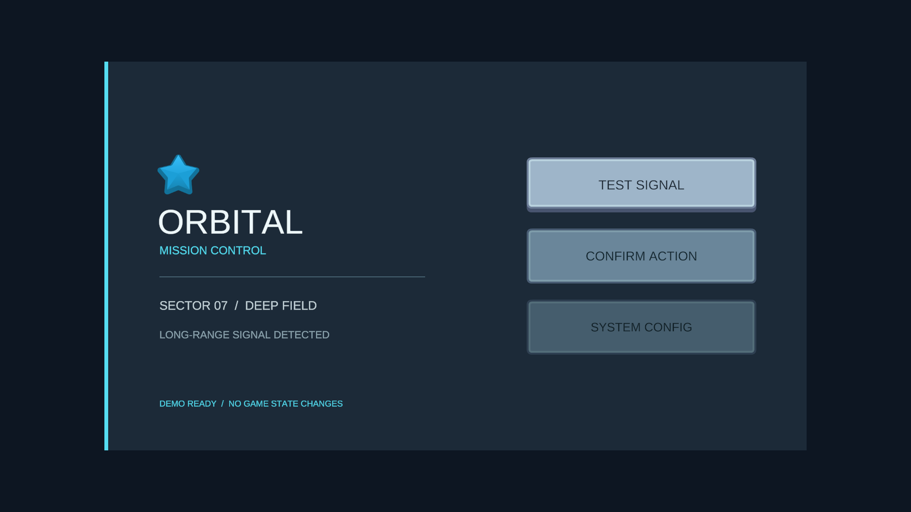
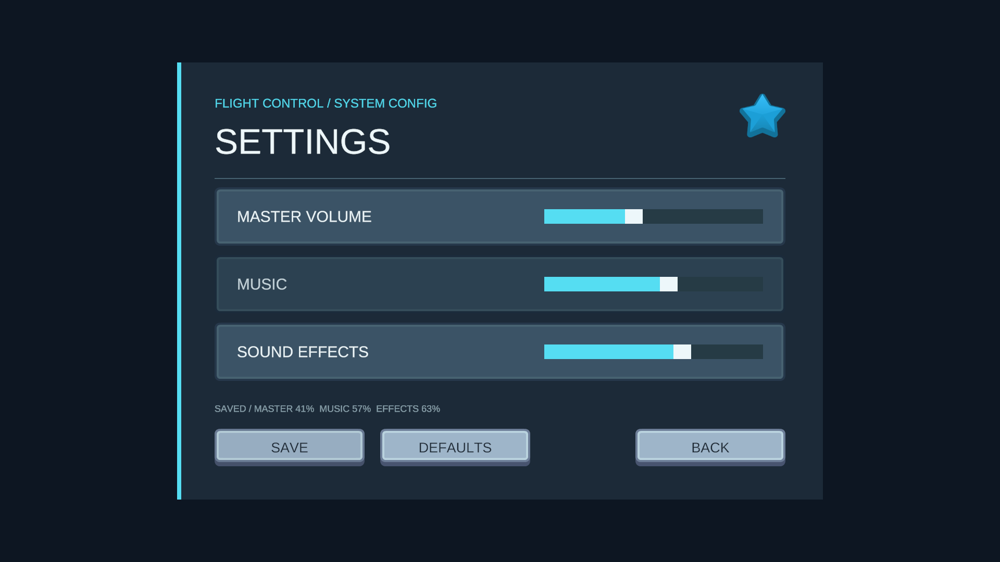
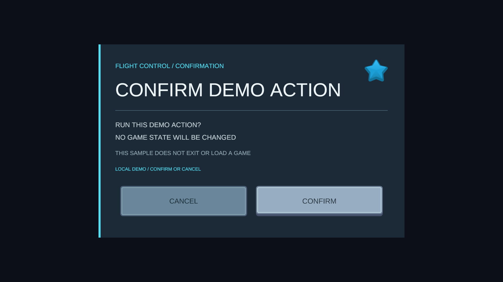

# UI Agent Tools

把“我想要一个这样的菜单”，变成 Unity 里可以继续编辑的 Prefab。

UI Agent Tools 希望让 Agent 帮你完成游戏 UI 的重复搭建：整理界面描述、从已有图片中挑选素材、组织层级与布局，再检查生成结果。你可以先确认素材和生成计划，再让工具创建新版本；每个结果都保留为标准 uGUI Prefab，方便在 Unity 中检查、微调和接入游戏。

这是一个以 **Unity 游戏菜单与素材拼装** 为起点的个人开源学习项目，免费使用，采用 MIT 许可。目前适合主菜单、设置面板、暂停菜单和确认弹窗的原型制作。

## 看看它能做什么

以下是开发过程中通过 Spec 生成、再接入示例逻辑的实际 Game View 截图。

**主菜单：** 使用已有 Sprite、配色和排版组织完整界面。



**设置面板：** 同一风格复用到不同布局；可通过可选 Sample 接入 AudioMixer 和显式保存。



**确认弹窗：** 提供背景点击阻断、确认/取消回调和关闭后的焦点恢复。



截图使用 Kenney CC0 素材与 Liberation Sans 字体，详见[截图来源](Documentation~/image-credits.md)。首发附带截图作为效果展示，不包含这些素材源文件、生成的 Prefab 或已接线的演示场景。

## 从描述到 Prefab

```text
描述界面 → Agent 整理为 UI Spec → 查询并选择项目内素材
        → 校验与展示生成计划 → 开发者确认 → 新 Prefab → 审计与问题定位
```

Spec 是界面的结构化说明：记录层级、文字、布局和准确的资源引用。自然语言需求与明确的拼装描述共用这条管线。

- **素材拼装：** 支持 Single Sprite、Multiple 图片表子图，以及 Simple / Sliced 九宫格引用；配套 Bridge 可打开素材候选网页供选择。
- **组合生成：** 支持 Panel、Text、Button、Toggle、Slider 和受限确认弹窗，生成前检查字体、资源和输出位置。
- **结果检查：** 读取层级、对照 Spec 审计 Prefab，定位文字溢出、越界和拉伸风险；修订通过新 Spec 和新 Prefab 验证。

## 如何开始

需要 **Unity 2022.3**；当前实测为 **2022.3.62f3c1**。uGUI、TMP 和 Newtonsoft Json 依赖由 Package Manager 解析，生成时需自行准备覆盖文案的 TMP Font Asset。

**安装 Package**：从 [Releases](https://github.com/hongdouni131/ui-agent-tools/releases) 下载 ZIP，解压到固定目录。在 Unity 的 **Window → Package Manager → + → Add package from disk...** 中选择内层 `package/package.json`，等待依赖和编译完成。不要删除或移动被引用的目录。

**用 Agent 操作**：另外安装 [Funplay MCP for Unity](https://github.com/FunplayAI/funplay-unity-mcp) 和 [Codex-Funplay Bridge v0.3.0](https://github.com/hongdouni131/codex-funplay-unity-bridge/releases/tag/v0.3.0)，让 Bridge 指向同一 Unity 项目。随后告诉 Agent 想做什么界面，由它检查环境、整理 Spec 并展示计划。Package 安装不会自动给 Codex 注册工具；素材页提交也不等于生成授权。

**直接用 C# API**：不使用 Agent 也能调用检查、校验和生成 API；[使用指南](Documentation~/usage.md)提供可复制的首次检查代码、API 入口和测试方法。当前 Package 提供代码 API，没有内置可视化生成窗口。

## 验证与当前边界

核心 EditMode 回归已在隔离消费项目中通过 **321/321**；空项目安装、三项 Sample 导入和真实 Bridge 配对也已验证。详细范围见[首发说明](RELEASE.md)。

当前以桌面菜单为范围。工具不会生成游戏业务代码或原地覆盖已有 Prefab；项目需提供 EventSystem、资源和业务接线。截图中的菜单流程由可选 Sample 接入，安装后不会自动出现。移动端、SpriteAtlas 打包、实体手柄和 Player 构建尚未纳入此次验收。

欢迎阅读源码、提出问题，或用自己的素材尝试新的界面。[MIT 许可证](LICENSE)允许使用、修改和再分发；第三方资源适用各自许可。
